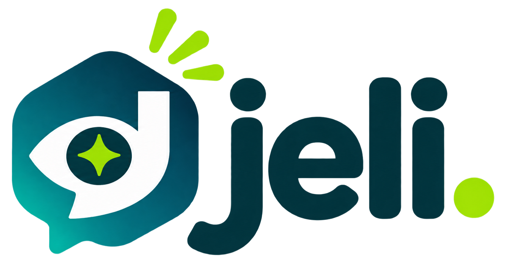
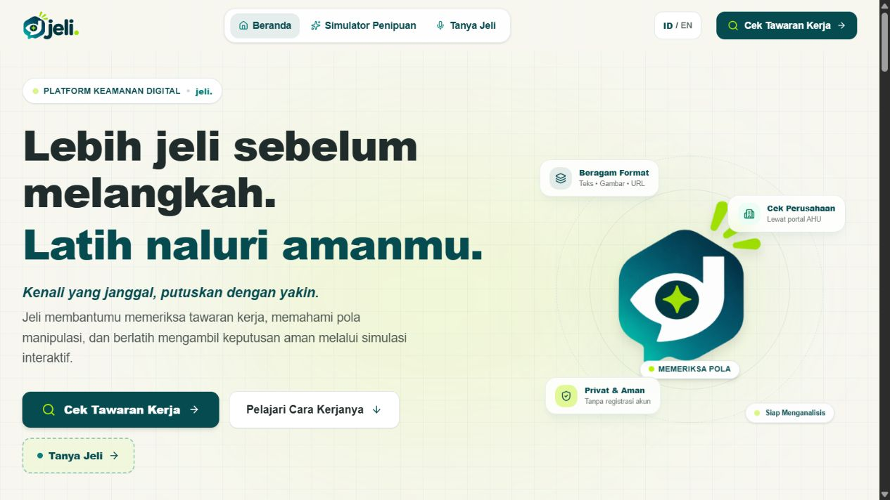
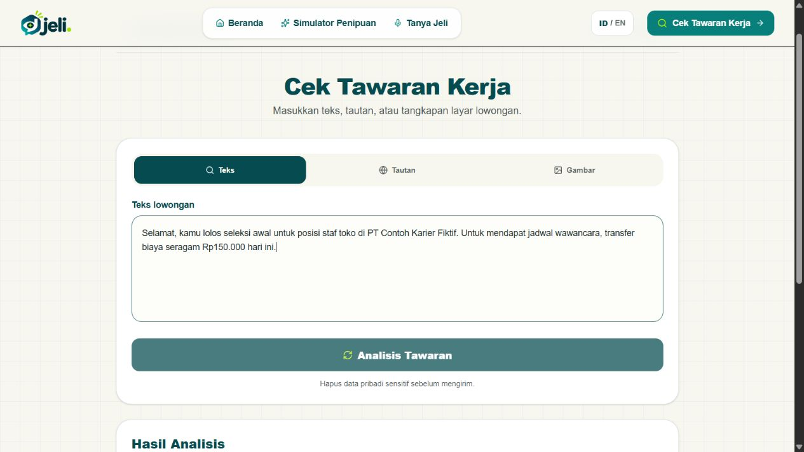
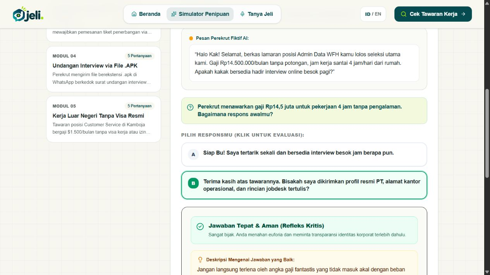
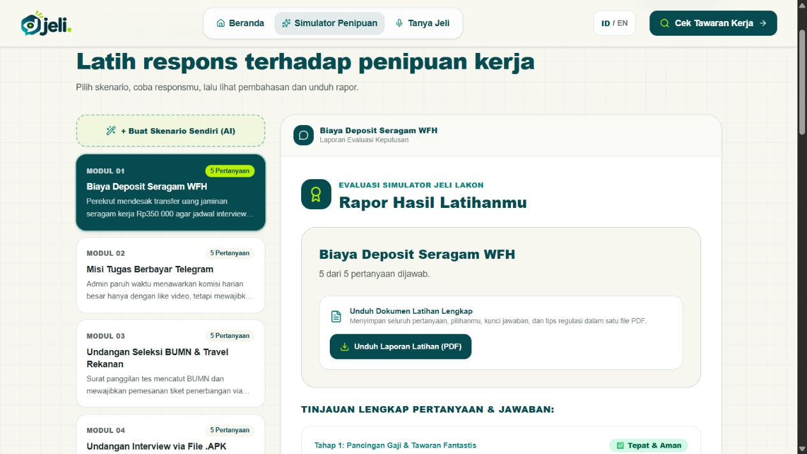
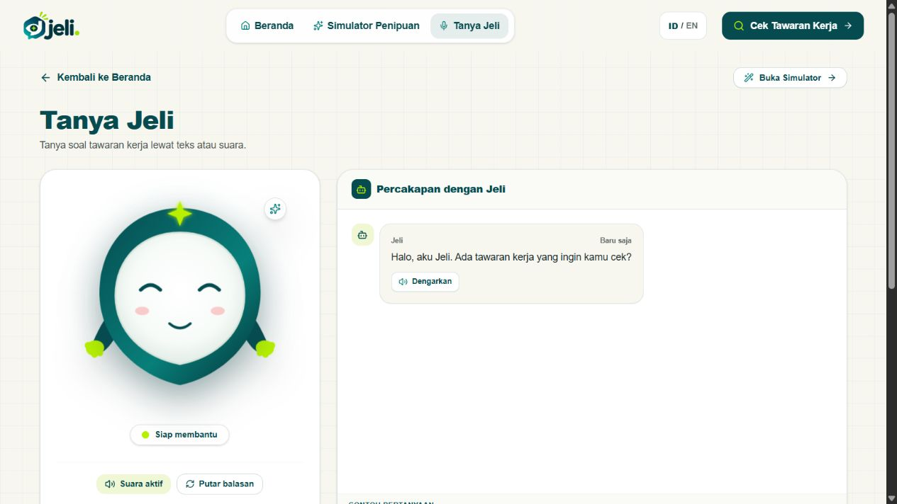
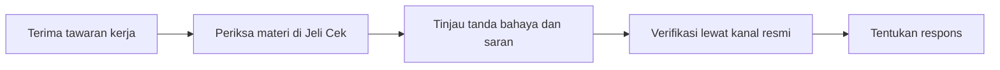
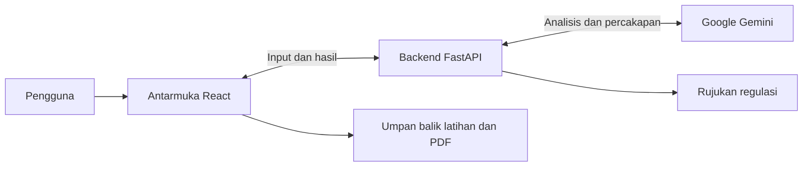

  

<h1 align="center">Jeli</h1>

<strong>Lebih jeli sebelum melangkah.</strong>

  Jeli membantu pencari kerja muda mengenali tanda penipuan rekrutmen, berlatih merespons tawaran mencurigakan, dan menentukan langkah verifikasi yang lebih aman.

<strong>MIT-Week 2026 · Web Development Competition</strong>

  
  
  

  <a href="https://jeli-mit.vercel.app/#home"><strong>Buka situs live</strong></a> ·
  <a href="#video-demonstrasi-dan-live-website">Video demonstrasi</a> ·
  <a href="#fitur-unggulan">Jelajahi fitur</a>

## Latar belakang

Saat menunggu kabar lamaran, pesan yang mengundang wawancara bisa terasa seperti kesempatan yang sayang dilewatkan. Pesan itu mungkin memakai nama perusahaan yang dikenal, menjanjikan pekerjaan dengan gaji menarik, lalu meminta biaya seragam atau dokumen pribadi dengan tenggat yang singkat. Bagi pencari kerja muda yang baru mengenal proses rekrutmen, desakan untuk segera membalas membuat tawaran seperti ini semakin sulit dinilai.

Kami mengembangkan Jeli untuk membantu pengguna pada saat harus mengambil keputusan itu. Pencari kerja perlu memahami bagian mana dari pesan yang patut dicermati, informasi apa yang masih kurang, dan bagaimana memastikan tawaran melalui jalur yang dapat dipercaya.

## Mengenal Jeli

Jeli adalah platform keamanan digital yang berfokus pada penipuan lowongan kerja dan rekrutmen. Kami merancangnya untuk pelajar dan mahasiswa yang mulai mencari pengalaman kerja, lulusan baru, serta pencari kerja muda yang menerima tawaran melalui pesan, surel, atau situs lowongan.

Dalam satu aplikasi, pengguna dapat memeriksa materi yang mereka terima, mencoba respons terhadap perekrut fiktif, dan bertanya ketika masih ragu. Pemeriksaan membantu pengguna menghadapi satu tawaran tertentu. Latihan memberi kesempatan untuk mengenali pola serupa ketika menemui tawaran lain. Jeli tersedia dalam bahasa Indonesia dan Inggris serta dapat digunakan tanpa membuat akun.

## Fitur unggulan

### Jeli Cek

Jeli Cek memeriksa risiko tawaran kerja dari **teks, tangkapan layar, atau tautan publik**. Penilaian berbasis Gemini membantu pengguna melihat indikasi seperti permintaan pembayaran di muka dan tekanan waktu. Hasilnya memuat kategori risiko, alasan, kutipan dari materi yang diperiksa jika tersedia, serta saran verifikasi.

Pengguna dapat menyalin draf balasan aman, membuka pencarian profil perusahaan melalui portal AHU, atau menyimpan hasil sebagai PDF. Kategori risiko bersifat indikatif. Gunakan hasilnya untuk menentukan hal yang perlu dikonfirmasi melalui kanal resmi perusahaan. [Coba Jeli Cek](https://jeli-mit.vercel.app/#checker).

### Jeli Lakon

Jeli Lakon mengajak pengguna memilih respons dalam percakapan rekrutmen fiktif. Lima skenario bawaan mencakup deposit seragam, tugas berbayar, undangan seleksi dengan agen perjalanan, berkas APK yang menyamar sebagai undangan, dan tawaran kerja luar negeri tanpa visa resmi.

Setiap pilihan langsung memunculkan pembahasan. Dalam skenario deposit seragam, misalnya, pengguna dapat membandingkan respons yang langsung menyanggupi wawancara dengan respons yang meminta profil resmi perusahaan dan rincian pekerjaan. Di akhir latihan, pengguna bisa meninjau jawaban serta mengunduh rapor PDF. Pengguna juga dapat memasukkan ide kasus fiktif untuk membuat latihan dengan pengantar yang disesuaikan dan pertanyaan dari modul terkurasi. [Coba Jeli Lakon](https://jeli-mit.vercel.app/#simulator).

Lihat rapor setelah latihan selesai

### Sahabat Jeli

Sahabat Jeli adalah pendamping berbasis AI dengan avatar interaktif. Melalui menu **Tanya Jeli**, pengguna dapat mengajukan pertanyaan seperti bagaimana menanggapi permintaan biaya seragam atau apa yang perlu dicek saat menerima undangan wawancara. Pertanyaan dapat diketik atau didiktekan pada browser yang mendukung mikrofon. Pengguna juga dapat memilih untuk mendengarkan balasan. [Buka Tanya Jeli](https://jeli-mit.vercel.app/#avatar).

## Alur penggunaan

Ketika menerima tawaran yang meminta transfer sebelum wawancara, pengguna dapat menyalin pesan ke Jeli Cek setelah menyamarkan informasi pribadi. Dari hasil pemeriksaan, pengguna dapat meninjau alasan permintaan itu patut dicermati dan mencari kontak resmi perusahaan secara mandiri sebelum membalas. Jeli Lakon menyediakan skenario serupa untuk berlatih menghadapi tekanan tersebut.

## Kesesuaian dengan tema MIT-Week 2026

> Guardians of the Digital Space – Empowering Today's Generation Toward a Safer Cyber Ecosystem

Kami menerapkan tema ini pada keputusan sehari-hari pencari kerja muda ketika menerima tawaran yang meragukan. Tiga pendekatan studi kasus terhubung dalam pengalaman menggunakan Jeli.

| Pendekatan | Penerapan di Jeli |
| --- | --- |
| **Recognize** · Kenali | Jeli Cek membantu pengguna menemukan indikasi risiko dan memahami konteks di baliknya. |
| **Learn** · Pelajari | Jeli Lakon melatih pengguna membandingkan respons dan memahami konsekuensi tiap pilihan dalam kasus fiktif. |
| **Act** · Bertindak | Jeli mengarahkan pengguna ke langkah yang bisa dilakukan, seperti menunda pembayaran, mencari kanal resmi perusahaan, atau meminta klarifikasi dengan balasan yang aman. |

## Teknologi dan arsitektur

| Teknologi | Peran dalam Jeli |
| --- | --- |
| **React, TypeScript, Vite, dan Tailwind CSS** | Membangun antarmuka web, interaksi latihan, dan tampilan dalam dua bahasa. |
| **Python dan FastAPI** | Menerima input, menyediakan skenario latihan, dan menghubungkan aplikasi dengan Gemini serta rujukan regulasi. |
| **Google Gemini** | Menganalisis materi rekrutmen, menyesuaikan pengantar skenario, dan merespons pertanyaan di Sahabat Jeli. |
| **Web Speech API dan layanan sintesis suara** | Mendukung dikte dan pembacaan balasan pada Sahabat Jeli. |
| **jsPDF** | Menghasilkan laporan pemeriksaan dan rapor latihan di browser. |

FastAPI menghubungkan antarmuka Jeli dengan layanan AI dan rujukan resmi. Setelah skenario terpandu dimuat, pilihan dan umpan balik latihan diproses di browser.

## Rujukan dan pendekatan keamanan

Jika relevan dengan materi yang diperiksa, Jeli Cek dapat menampilkan rujukan resmi di bagian terpisah dari penilaian risiko. Salah satunya adalah Pasal 11 Permenaker Nomor 18 Tahun 2024, yang mengatur pungutan biaya penempatan oleh Pelaksana Penempatan Tenaga Kerja Swasta (PPTKS) dan memuat pengecualian untuk jabatan tertentu. Penilaian Jeli bersifat indikatif, dan penerapan aturan bergantung pada fakta kasus. [Baca Pasal 11 di JDIH Kemnaker](https://jdih.kemnaker.go.id/asset/data_puu/2024pmnaker018.pdf#page=7).

Gunakan contoh fiktif atau samarkan data pribadi sebelum mengirim. Jeli mengirim materi pemeriksaan, prompt latihan kustom, dan isi percakapan ke Gemini melalui backend. Fitur pembacaan suara dapat meneruskan teks balasan ke penyedia sintesis suara.

## Video demonstrasi dan live website

| Materi | Akses |
| --- | --- |
| Situs live | [Buka Jeli](https://jeli-mit.vercel.app/#home) |
| Video demonstrasi · maksimal 5 menit |[https://drive.google.com/drive/folders/11HcbpnGFz4UnpxVIa-04SdCE7CDHotaT]|
| Kode sumber | [MIT_WEEK2026 di GitHub](https://github.com/jona-2212/MIT_WEEK2026) |
| Dokumentasi teknis | [Panduan Pengembangan](docs/DEVELOPMENT.md) |

## Tim pengembang

Jeli dikembangkan oleh **papipapipum**, tim peserta Web Development Competition MIT-Week 2026.

| Anggota | Peran |
| --- | --- |
| Jonathan Salim | Fullstack Engineer |
| Gregorius Petrus Leslie | Product Manager |
| Ilham Rafiqin | AI Engineer |

[Riwayat kontribusi proyek](https://github.com/jona-2212/MIT_WEEK2026/graphs/contributors)

## Dokumentasi pengembangan

Untuk informasi instalasi lokal, konfigurasi environment, dan panduan pengembangan, silakan lihat [Panduan Pengembangan](docs/DEVELOPMENT.md).

## Penutup

Kami ingin pencari kerja muda merasa punya waktu dan cara untuk memeriksa tawaran sebelum mengambil keputusan. Lewat Jeli, kebiasaan itu dimulai dari tindakan yang bisa langsung dipraktikkan saat pesan berikutnya datang. Baca dengan cermat, tanyakan yang belum jelas, dan pastikan lewat sumber resmi.
